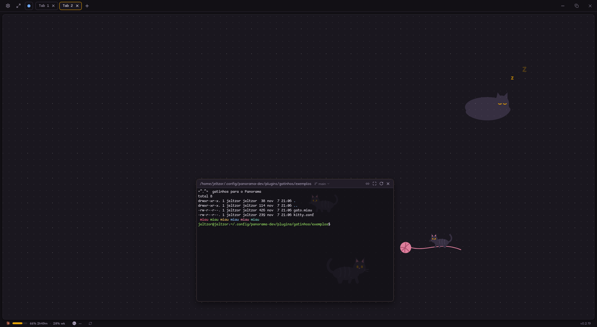
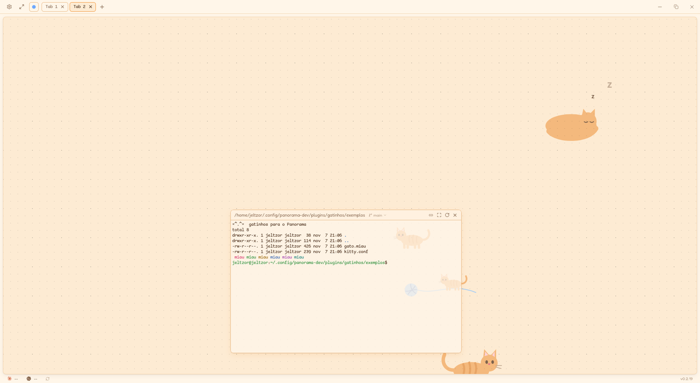
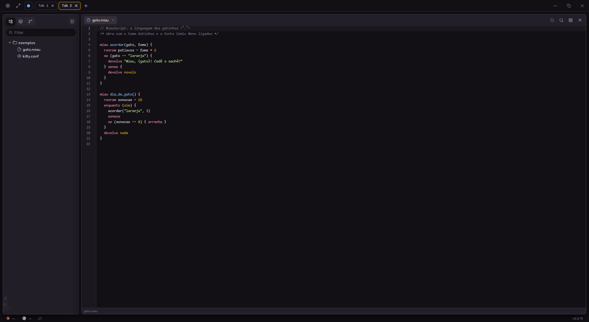
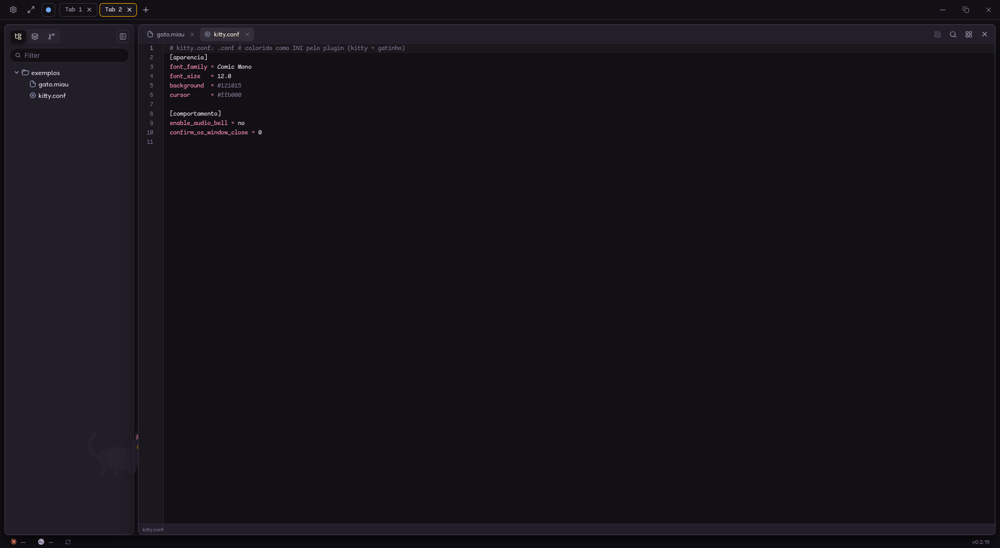
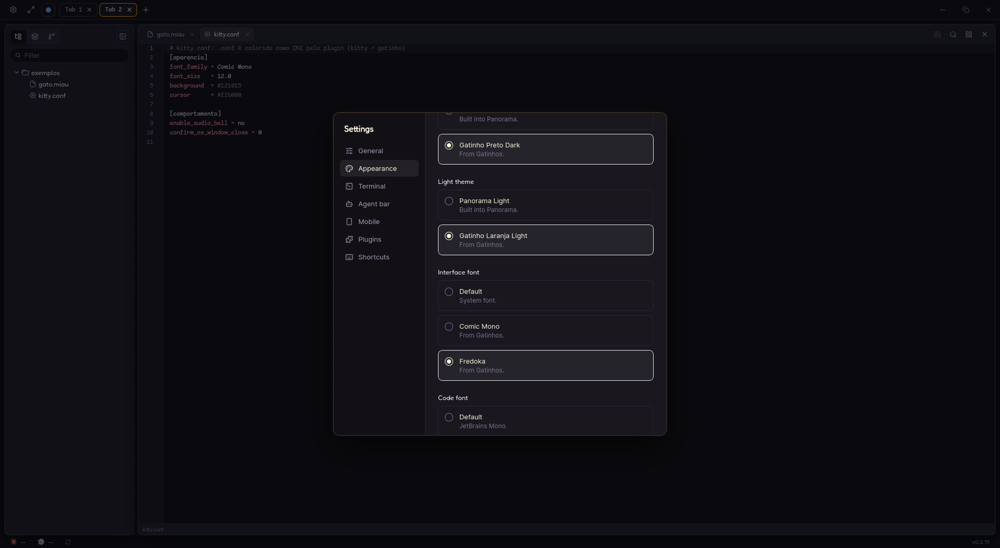
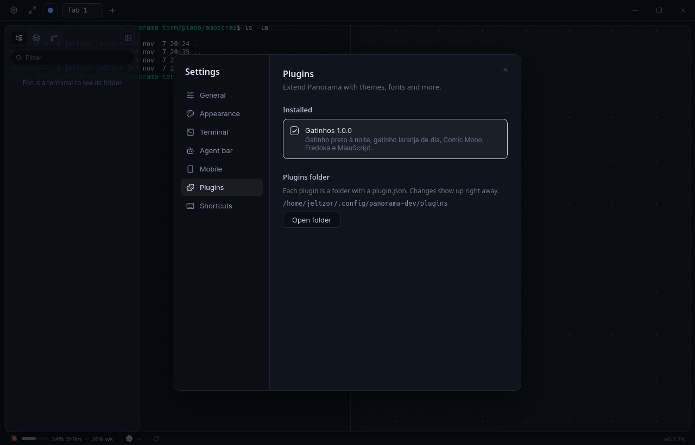
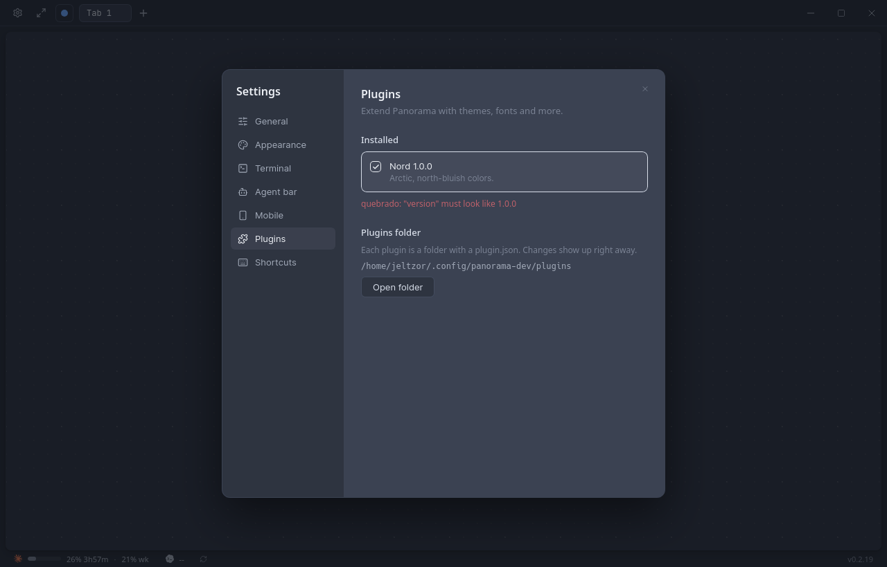

# Gatinhos 🐈‍⬛🐈

Um plugin para o [Panorama](https://github.com/Frenvius/panorama-term) que usa todos os
pontos de extensão de plugins declarativos de uma vez. Serve para deixar o Panorama com
cara de gato e como modelo para quem quer fazer o próprio plugin.

*English: a Panorama plugin with two cat themes (with cats walking behind the
terminals), two fonts, a made-up language with its own grammar and an extension mapping.
Install it by cloning this repository into Panorama's plugins folder as `gatinhos`
(commands below).*



## O que vem

| Tipo | O quê |
| --- | --- |
| Tema escuro | **Gatinho Preto Dark**: pelo quase preto, olhos âmbar e nariz rosa |
| Tema claro | **Gatinho Laranja Light**: creme com laranja de gato rajado |
| Fonte (código e terminal) | **Comic Mono**, monoespaçada |
| Fonte (interface) | **Fredoka**, redonda e fofa |
| Linguagem nova | **MiauScript** (`.miau`), com gramática própria em `syntaxes/` |
| Extensão associada | `.conf` colorido como **INI** (pense no `kitty.conf`) |
| Fundo animado | os **seus** gatos atrás dos terminais, com raça e nome, comendo, brincando com o novelo, afiando as unhas, cochilando na almofada e passeando pela tela |

Os temas mudam as cores do app, do código e as 16 cores ANSI do terminal, deixam os
terminais um pouco transparentes e sem desfoque, para os gatinhos aparecerem atrás.

| Gatinho Laranja Light | MiauScript no editor |
| --- | --- |
|  |  |
| **`kitty.conf` como INI** | **Settings → Appearance** |
|  |  |

> **Aviso de desempenho:** o fundo animado é um SVG, e o motor web do Panorama redesenha
> a imagem inteira a cada quadro enquanto ela aparece. Num notebook comum isso ocupa
> perto de um núcleo da CPU (medido no Linux). O custo é só deste tema: escolha outro
> tema (ou ative "reduzir movimento" no sistema) e ele some. O fundo também some quando
> um terminal está em tela cheia.

## Requisitos

O suporte a plugins (temas, fontes, linguagens e fundo do canvas)
[entrou no Panorama](https://github.com/Frenvius/panorama-term/pull/6) depois da
v0.2.19. Até sair a próxima versão, rode o Panorama a partir do código:

```sh
git clone https://github.com/Frenvius/panorama-term
cd panorama-term && bun install && bun run dev
```

(precisa de Rust, [bun](https://bun.sh) e das
[dependências do Tauri](https://v2.tauri.app/start/prerequisites/)). Nessa versão de
desenvolvimento a pasta de plugins é a `panorama-dev` (veja abaixo).

## Instalar

O plugin é esta pasta inteira, e ela precisa se chamar `gatinhos` (igual ao `id` do
`plugin.json`). O jeito mais simples é clonar direto na pasta de plugins do Panorama.

**Linux**

```sh
git clone https://github.com/FlavioDias97/panorama-gatinhos ~/.config/panorama/plugins/gatinhos
```

**macOS**

```sh
git clone https://github.com/FlavioDias97/panorama-gatinhos "$HOME/Library/Application Support/panorama/plugins/gatinhos"
```

**Windows** (PowerShell)

```powershell
git clone https://github.com/FlavioDias97/panorama-gatinhos "$env:APPDATA\panorama\plugins\gatinhos"
```

Sem git: baixe o ZIP (botão **Code → Download ZIP**), extraia na pasta de plugins e
renomeie a pasta extraída de `panorama-gatinhos-main` para `gatinhos`.

O plugin aparece na hora em **Settings → Plugins**, sem reiniciar.

Se você roda o Panorama a partir do código (`bun run dev`), troque `panorama` por
`panorama-dev` no caminho.



## Usar

Em **Settings → Appearance**:

- **Dark theme** → *Gatinho Preto Dark*, **Light theme** → *Gatinho Laranja Light*
  (em *System*, o Panorama alterna entre os dois junto com o sistema);
- **Interface font** → *Fredoka*;
- **Code font** e **Terminal font** → *Comic Mono*.

Abra `exemplos/gato.miau` e `exemplos/kitty.conf` no editor do Panorama para ver as
linguagens.

## Seus gatos

Os gatos do fundo vêm de um arquivo `gatos.json` na pasta do plugin. O jeito mais fácil
de criar o seu é responder às perguntas do `gerar.py` (precisa de Python 3, sem instalar
nada):

```sh
cd ~/.config/panorama/plugins/gatinhos
python3 fundo/gerar.py --configurar
```

Ele pergunta nome, raça, do que gosta e tamanho de cada gato, grava o `gatos.json` e gera o
fundo. Para editar à mão, copie o exemplo, mude o que quiser e gere de novo:

```sh
cp gatos.exemplo.json gatos.json
python3 fundo/gerar.py
```

O Panorama troca o fundo na hora. Um `gatos.json` com dois gatos:

```json
{
  "nomes": true,
  "gatos": [
    { "nome": "Mingau", "raca": "siames", "faz": "dormindo" },
    { "nome": "Frajola", "raca": "frajola", "faz": "brincando", "tamanho": 0.7 }
  ]
}
```

Cada gato tem:

| Campo | O quê |
| --- | --- |
| `nome` | aparece em cima do gato; `"nomes": false` esconde todos |
| `raca` | `siames`, `frajola`, `preto`, `branco`, `cinza`, `laranja`, `rajado`, `tricolor` ou `escaminha` (acento não importa) |
| `faz` | do que o gato mais gosta, veja abaixo |
| `tamanho` | opcional, de `0.3` a `2`; `1` é o normal, `0.6` um filhote |
| `cores` | opcional, troca a cor de uma parte, como `{ "olhos": "#5fa8ff", "patas": "branco" }` |

As partes que `cores` aceita: `pelo`, `listras`, `manchas` (uma lista), `barriga`,
`pernas`, `patas`, `rabo`, `orelhas`, `orelhaDentro`, `rosto`, `focinho`, `olhos` e
`nariz`. Uma cor é `"#rrggbb"`, ou `"preto"`/`"branco"`, que se ajustam ao tema para o
gato não sumir no fundo. Gatos que ficariam pouco visíveis num dos temas ganham um
contorno nele.

### O que eles fazem

Todo gato faz de tudo um pouco: anda até o pote e come, afia as unhas no arranhador, dá
tapinhas no novelo, cochila na almofada, se lambe, senta para olhar, sai da tela e volta
pelo outro lado. Cada um segue uma ordem só dele, e `faz` diz do que ele mais gosta:

| `faz` | O gato |
| --- | --- |
| `andando` | vive passeando, sai e volta pela tela |
| `brincando` | vive brincando com o novelo e dando corridinhas |
| `dormindo` | cochila muito na almofada |
| `sentado` | senta e fica olhando |
| `lambendo` | se lambe o tempo todo |
| `caseiro` | dorme dentro da casinha (só o rabo fica de fora) e sai para comer |

Os objetos ficam parados no chão do cenário: arranhador, novelo, pote, almofada e, se
algum gato for `caseiro`, a casinha. Para pôr a casinha mesmo sem um gato caseiro, liste-a
em `"objetos"`, como em `"objetos": ["casinha"]`.

Se algo estiver errado, o `gerar.py` diz qual gato e o que usar no lugar, e não mexe no
fundo. Cada gato é mais uma animação para desenhar: com mais de 6 o fundo pesa mais na CPU (o
`gerar.py` avisa).

## Atualizar e remover

```sh
cd ~/.config/panorama/plugins/gatinhos
git checkout -- fundo/*.svg && git pull && python3 fundo/gerar.py   # atualizar
rm -rf ~/.config/panorama/plugins/gatinhos                          # remover
```

O `gatos.json` é seu e o `git pull` não mexe nele. Os SVGs do fundo são gerados a partir
dele, por isso o `checkout` antes do `pull` e o `gerar.py` depois.

Para só desligar sem remover, use o interruptor em **Settings → Plugins**; o Panorama
volta para o próprio tema e as próprias fontes.

## Fazer o seu

Tudo está no `plugin.json`: copie este repositório, troque o `id` (e o nome da pasta),
e mexa no que quiser. A referência completa de cada campo está no guia de plugins do
Panorama: [português](https://github.com/Frenvius/panorama-term/blob/main/docs/PLUGINS.pt-BR.md)
· [English](https://github.com/Frenvius/panorama-term/blob/main/docs/PLUGINS.md).

Se o `plugin.json` tiver algum erro, o Panorama mostra o plugin em **Settings →
Plugins** com o motivo, na hora em que você salva:



```
gatinhos/
├── plugin.json                         manifesto: temas, fontes e linguagens
├── fonts/                              Comic Mono e Fredoka, com as licenças
├── syntaxes/miauscript.tmLanguage.json gramática TextMate do MiauScript
├── gatos.exemplo.json                  os gatos do fundo (copie para gatos.json)
├── fundo/                              os gatinhos animados (SVG) e o gerar.py que os cria
├── prints/                             as imagens deste README
└── exemplos/                           gato.miau e kitty.conf
```

## Licença

MIT. As fontes mantêm as próprias licenças: Comic Mono (MIT,
`fonts/LICENSE-ComicMono.txt`) e Fredoka (SIL Open Font License 1.1,
`fonts/LICENSE-Fredoka.txt`).
